

  

<h1 align="center">Dahuang-WVP Server</h1>

  基于 RuoYi 与 WVP 的国标视频管理平台 · 开箱即用 · 完全开源 · MIT 协议

  
  
  
  
  
  

## 平台介绍

Dahuang-WVP 致力于面向安防视频联网场景的统一视频接入与管理平台。国标协议支持 GB/T 28181-2016，兼容 2022 版视频平台；集成 [ZLMediaKit](https://github.com/ZLMediaKit/ZLMediaKit) 提供媒体处理能力。目标是让视频接入更容易部署、更便于运维，也更容易定位问题。

平台以标准国标协议为主干，同时兼容主流厂商私有协议，对外提供统一 API，服务于上层业务系统。数据库支持 MySQL、PostgreSQL、达梦，并提供 SQLite 版本用于开箱即用的快速验证。

## 协议支持

| 协议 | 版本 | 状态 | 说明 |
| --- | --- | :---: | --- |
| ONVIF | Ver 2.0 / 1.0 | ✅ 完整支持 | 设备发现、PTZ 控制、事件订阅；Ver20 优先，Ver10 自动降级 |
| GB28181 | 2016 / 2022 | ✅ 完整支持 | 国标级联、点播、云台、回放、订阅通知 |
| 海康威视 | ISUP / Ehome | ✅ 完整支持 | 设备主动注册接入 |

**规划中**：海康综合安防平台、宇视 SDK、天地伟业 SDK、萤石、乐橙。

## 功能特性

### 设备接入

- 集成 Web 管理界面，开箱即用
- 跨平台服务，一次编译多端部署
- 支持 GB28181 设备接入，兼容 2016 与 2022 版视频平台
- 支持 ONVIF 设备接入与海康 ISUP/Ehome 主动注册
- 接入路数无限制，能接入多少设备只取决于服务器性能
- 支持平台对接接入与国标级联，可同时级联到多个上级平台

### 实时预览

- 支持 RTSP、RTMP、HTTP-FLV、Websocket-FLV、HLS 多种流地址输出
- 支持通过一个流地址直接观看摄像头，无需登录、无需调用任何接口
- 支持主码流与子码流切换
- 支持播放 H264 与 H265
- 支持检索、通道筛选与通道子目录查询

### 云台与对讲

- 云台控制，控制设备转向、拉近、拉远
- 预置位查询、设置与调用
- 语音对讲

### 录像与回放

- 查询 NVR/IPC 上的录像与播放，支持指定时间播放与下载
- 云端录像：推流、代理、国标视频均可录制到云端服务器，支持预览与下载
- 支持录像计划，按设定时间段对通道进行录制
- 支持流媒体节点集群与负载均衡

### 订阅与报警

- 支持订阅与通知方法
- 移动位置订阅、通知处理、查询与地图显示
- 报警事件订阅与通知处理，支持向前端实时推送报警信息
- 设备目录订阅与通知处理

### 国标级联

- 国标通道向上级联，WEB 端直接添加上级平台
- 注册、心跳保活、通道选择与通道推送
- 上级平台点播、云台控制、状态查询、信息查询、远程启动
- 支持目录订阅与通知

### 电子地图

- 支持展示通道位置，并在地图上直接修改通道位置
- 提供高德天地图常见地图引擎均可直接展示

## 技术栈

| 层次 | 选型 |
| --- | --- |
| 前端 | Vue 2、Element-UI、ECharts |
| 后端 | Spring Boot 2.7.18、Spring Security、MyBatis-Plus、Druid |
| 中间件 | Redis（缓存）、JWT（认证）、Quartz（调度） |
| 媒体 | ZLMediaKit |
| 数据库 | MySQL / PostgreSQL / 达梦 / SQLite |

## 模块说明

| 模块 | 职责 |
| --- | --- |
| `ruoyi-admin` | 启动模块与 Web 入口 |
| `ruoyi-framework` | 框架核心，安全、拦截、数据源 |
| `ruoyi-system` | 系统管理，用户、角色、菜单、字典 |
| `ruoyi-common` | 公共组件与工具 |
| `ruoyi-wvp` | 国标 GB28181 信令与业务 |
| `ruoyi-media` | 媒体服务对接与流管理 |
| `ruoyi-onvif` | ONVIF 设备接入 |
| `ruoyi-isup` | 海康 ISUP 接入 |
| `ruoyi-alarms` | 报警管理 |
| `ruoyi-quartz` | 定时任务 |
| `ruoyi-generator` | 代码生成器 |

## 快速开始

### 环境要求

| 依赖 | 版本 |
| --- | --- |
| JDK | 1.8 |
| Maven | 3.6+ |
| Redis | 5.0+ |
| ZLMediaKit | 建议使用配套版本 |

## 演示地址

| 端 | 地址 | 账号 | 密码 |
| --- | --- | --- | --- |
| Web 端 | https://wvp.zgdahuan.com:28081/ | `admin` | `admin1234` |
| 移动端 | https://wvph5.zgdahuan.com/ | `admin` | `admin1234` |

## 免安装版本

| 平台 | 下载地址 | 提取码 |
| --- | --- | :---: |
| Windows | [百度网盘](https://pan.baidu.com/s/1sQxZfxQZZc9V2cPUmUY5CQ?pwd=yef3) | `yef3` |
| Linux | [百度网盘](https://pan.baidu.com/s/1sACrz8eVY5PBByBf2nx9cQ?pwd=b2yb) | `b2yb` |

## 演示效果图

### 基础版功能

| | |
| :---: | :---: |
| 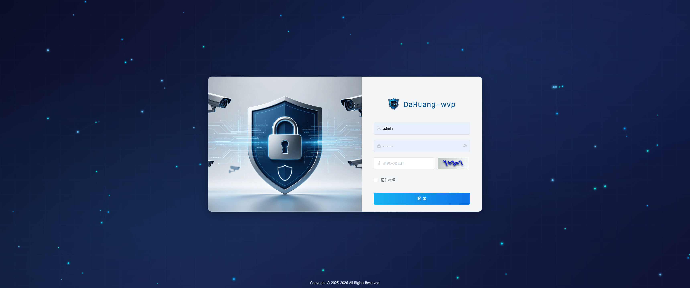 | 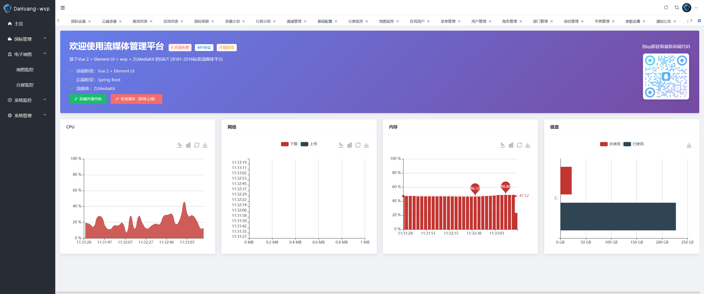 |
| 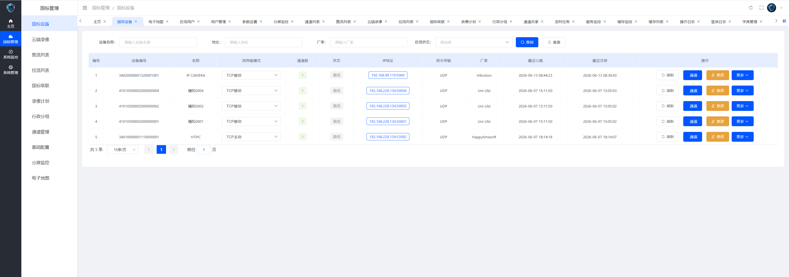 | 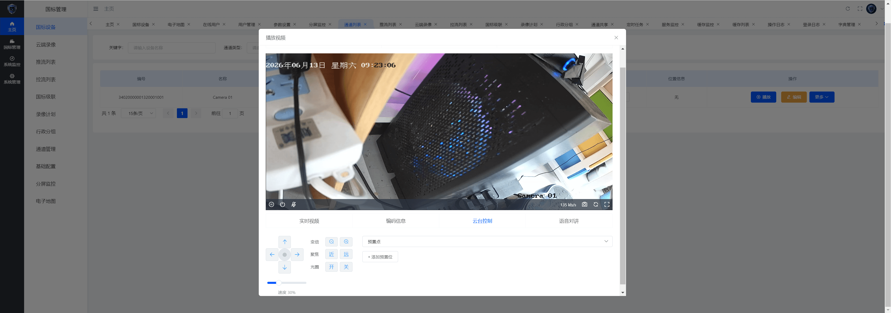 |
| 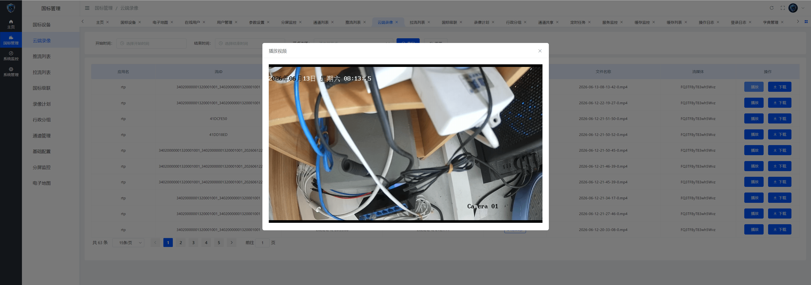 | 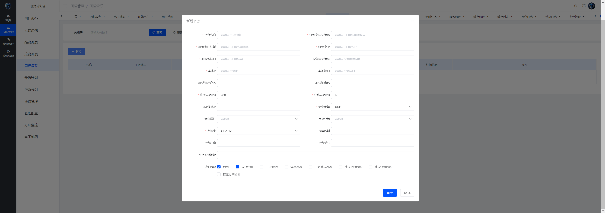 |
| 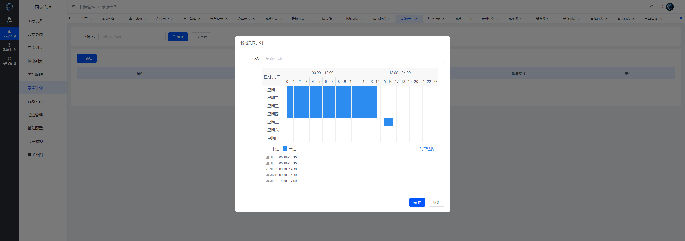 | 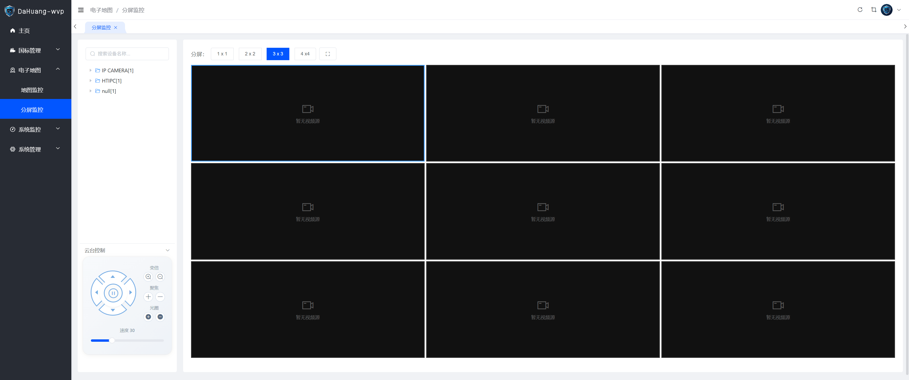 |
| 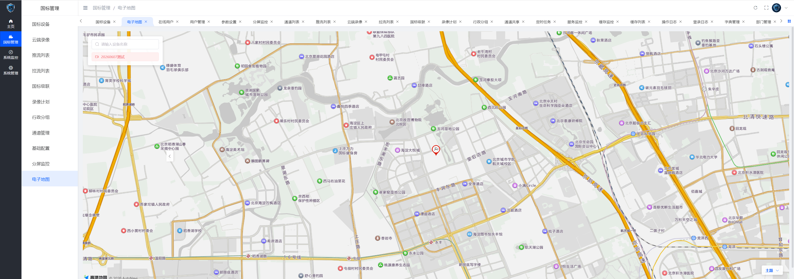 | 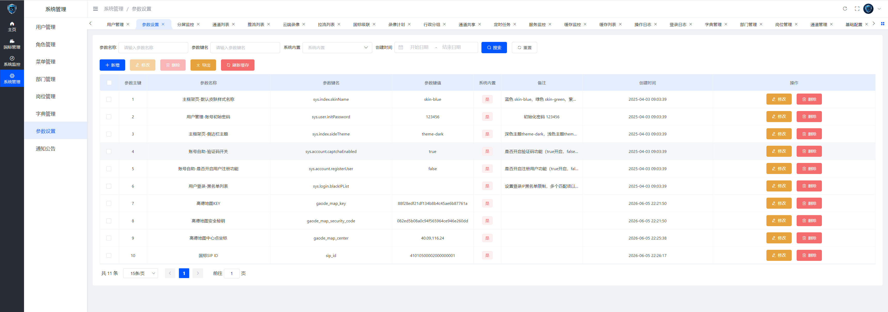 |

### Pro 版功能

| | |
| :---: | :---: |
| 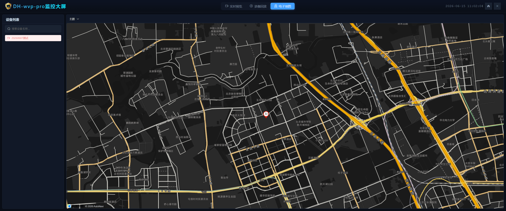 | 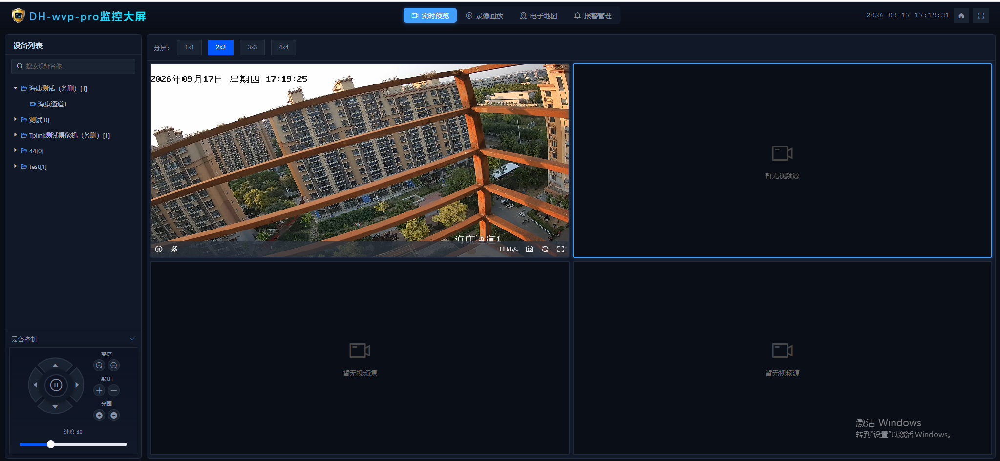 |
| 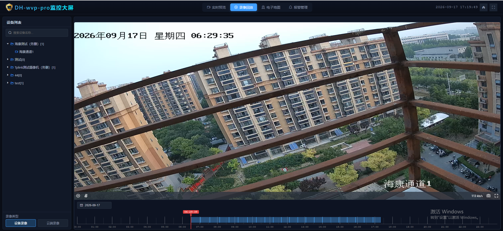 | 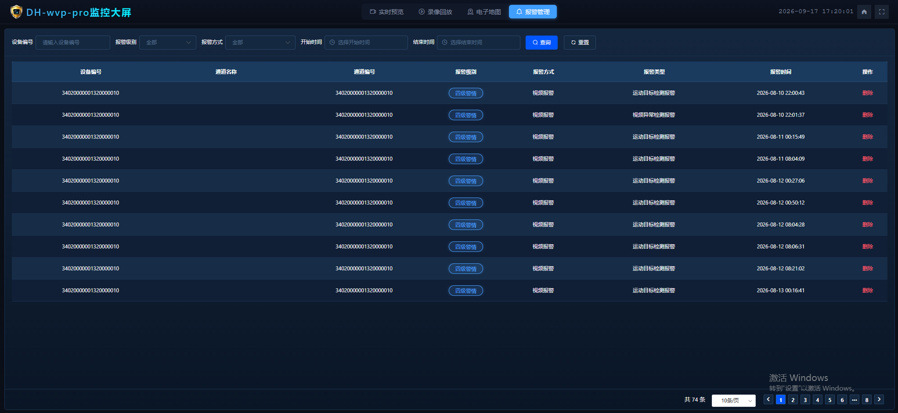 |

### 移动端

| | |
| :---: | :---: |
| 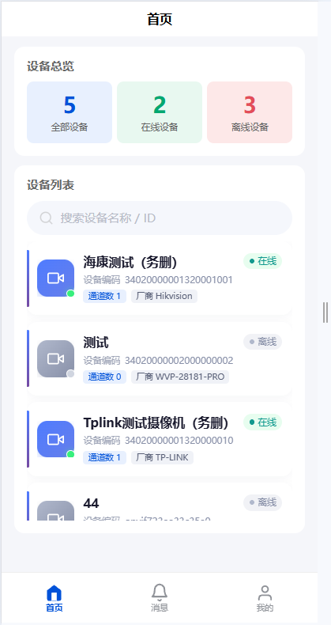 | 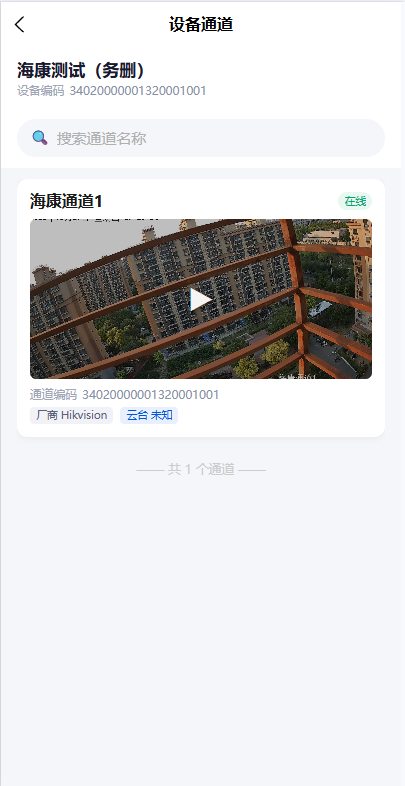 |
| 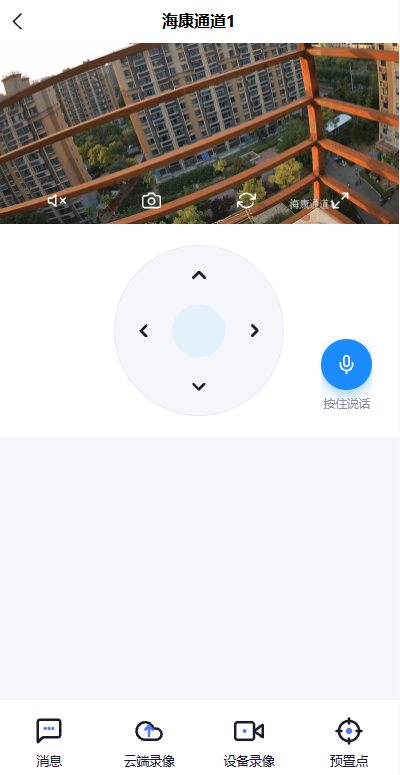 | 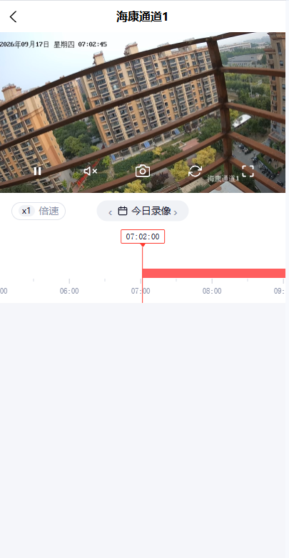 |
| 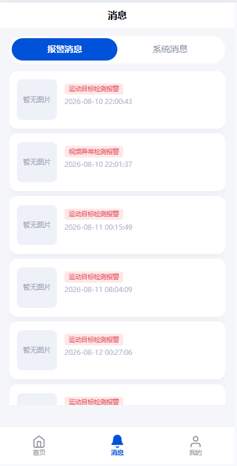 | 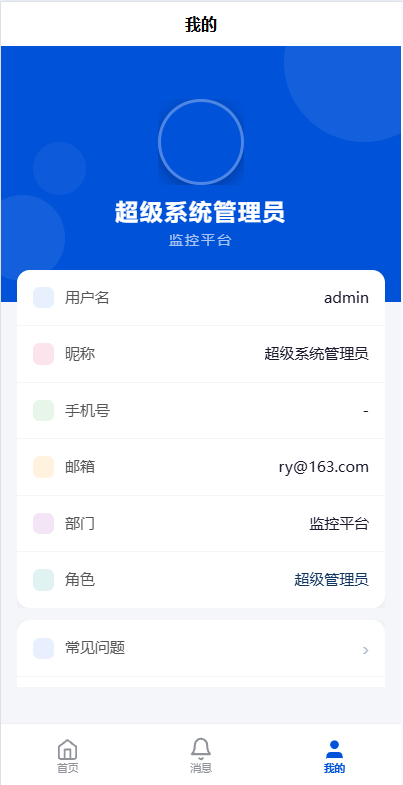 |

## 前端源码

加 QQ 群获取最新前端 Vue 代码。

  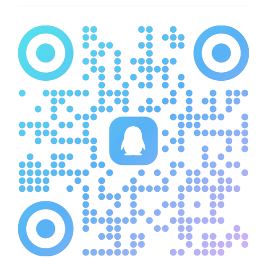

## 授权协议

本项目自有代码采用宽松的 **MIT** 协议，在保留版权信息的前提下可用于商业与非商业项目。

项目中零散使用了部分第三方开源代码，商用前请自行评估并替换或剔除；因使用本项目产生的商业纠纷或侵权行为与本项目及开发者无关，风险由使用者自行承担。二次分发时，请在授权协议中同时声明本项目所依赖的第三方库协议。

## 特别致谢

- [夏楚](https://github.com/xia-chu) — 开源了出色的流媒体服务框架 ZLMediaKit
- [WVP](https://github.com/648540858/wvp-GB28181-pro) — 开源了出色的国标服务器框架
- [若依](https://ruoyi.vip/) — 开源了高效的快速开发框架
- [公安县泉姒禾网络科技工作室](https://gitee.com/xiaochemgzi/RuoYi-Wvp.git) — 开源 WVP 集成方案
